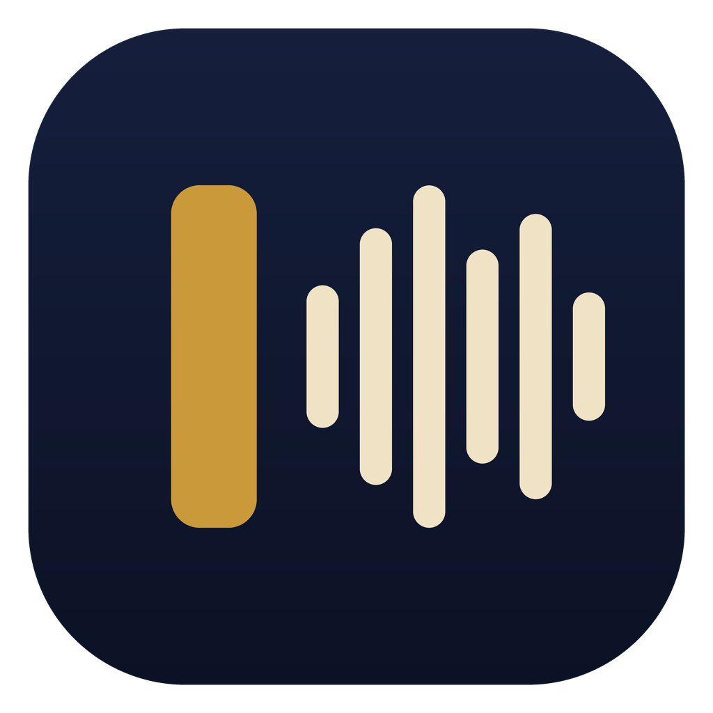
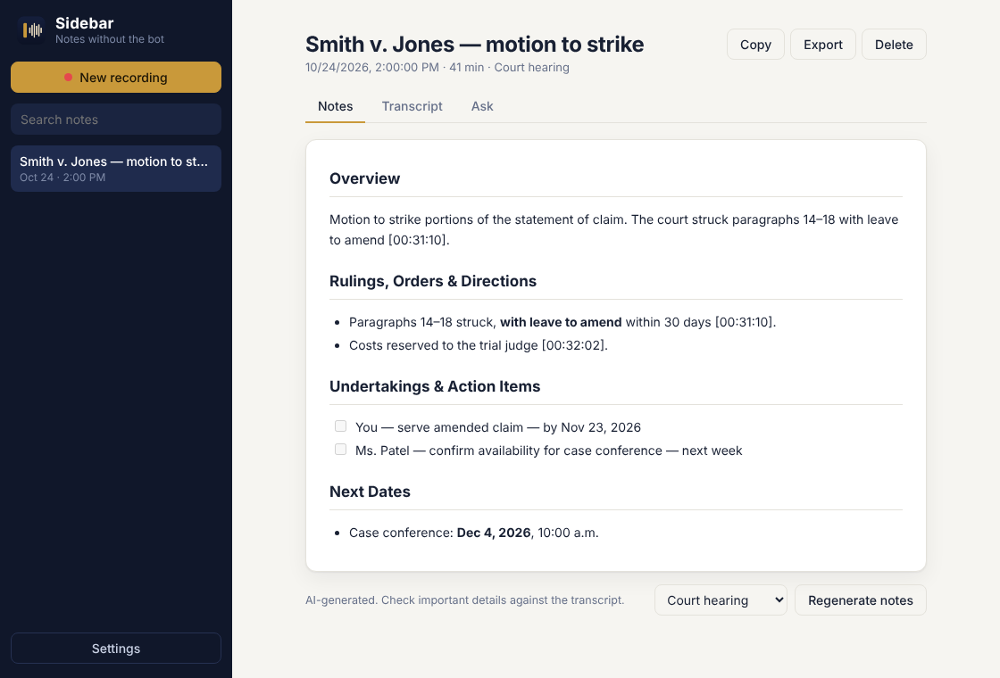
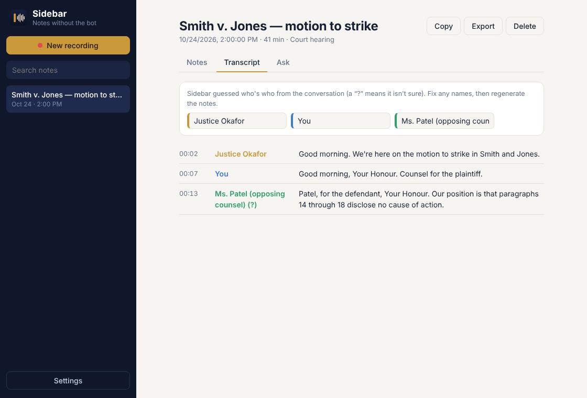

<p align="center"></p>

<h1 align="center">Sidebar</h1>
<p align="center"><b>The AI notetaker that never joins the call.</b><br/>Transcripts and summaries for Zoom, Teams and Meet, including court hearings where bots aren't allowed.</p>

<p align="center">
  <a href="https://github.com/jmh600cbr/notetaker/releases/latest"><b>⬇ Download Sidebar for Mac or Windows</b></a>
</p>

---

Most AI notetakers send a bot into your meeting. Courts and many clients won't admit a bot. Sidebar is a small desktop app for **Mac and Windows** that runs in your menu bar or system tray and records what *your own computer* hears: the call audio plus your microphone. Nothing joins the meeting and nobody sees a participant called "Notetaker".

When you stop recording, Sidebar:

1. **Transcribes** the audio, separating speakers (Deepgram Nova-3).
2. **Identifies who's who** from the conversation itself ("Thank you, Your Honour", "Patel, for the defendant").
3. **Writes the notes** with Claude, using a court-hearing, client-meeting or general template: rulings and directions, submissions, undertakings, action items and next dates, with timestamps.
4. Lets you **ask questions** about the meeting ("What deadlines were set?").



## Using it

1. Join your Zoom / Teams / Meet call as usual.
2. Click **Start recording**, or press **⌥⇧⌘R** (Option+Shift+Command+R) on Mac or **Ctrl+Alt+Shift+R** on Windows from anywhere. You can close the window; Sidebar keeps recording in the menu bar or tray.
3. Press the shortcut again, or click **Stop & make notes**. You'll get a notification when the notes are ready, usually within a minute or two.

Tips:

- **Wear headphones** if you can. Sidebar then records you and the call on separate channels, so your lines are always labelled "You". If you use laptop speakers, turn off "I usually wear headphones" in Settings to avoid duplicated lines.
- Add **names & terms** (party names, judge, case name) before recording. They noticeably improve spelling in the transcript.
- **Who's speaking:** Sidebar can't see Zoom's participant list (it isn't in the meeting), so it tells voices apart by sound and then works out names and roles from what's said. Guesses it isn't sure of are marked "?". Fix any names on the **Transcript** tab, then click **Regenerate notes**.
- **Pause** during recesses or breaks.



## Important: consent and court rules

Sidebar is a recording tool, so the rules on recording apply to it.

- **Courts:** many courts prohibit or restrict audio recording of proceedings, including virtual hearings, without the court's permission (in Ontario, for example, see s. 136 of the *Courts of Justice Act* and the court's practice directions on remote hearings). Check the applicable rules, or get the court's permission, before you record a hearing.
- **Everyone else:** recording laws vary. Tell participants and get consent where required.
- **Confidentiality:** audio goes to Deepgram for transcription and the transcript goes to Anthropic for summaries. Both offer business terms, and Anthropic's API does not train on your data by default. Confirm this meets your firm's policies, and consider zero-data-retention agreements with both vendors for privileged matters.

Sidebar shows this notice before the first recording.

## Install (for teammates)

1. Download the installer from the [latest release](https://github.com/jmh600cbr/notetaker/releases/latest): **Sidebar-vX.Y.Z-arm64.dmg** (Mac with Apple chip), **Sidebar-vX.Y.Z-x64.dmg** (Intel Mac) or **Sidebar-Setup-vX.Y.Z.exe** (Windows).
2. **Mac:** open the .dmg and drag Sidebar to Applications. **Windows:** run the installer.
3. Open Sidebar, click **Settings → Import team setup…** and choose the `sidebar-team-setup.json` file your admin sent you. That's it.

**First recording on a Mac:** macOS asks for **Microphone** and **Screen & System Audio Recording** access. Sidebar uses the second permission only to hear the call audio; it never records your screen. After granting it, quit and reopen Sidebar once.

> **Unsigned builds:** until the app is signed with an Apple Developer ID (see below), macOS says it can't verify Sidebar. Click **Done**, then go to **System Settings → Privacy & Security**, scroll down and click **Open Anyway**. You only need to do this once. Windows SmartScreen may show "Windows protected your PC": click **More info → Run anyway**.

## Setup (for the admin, once)

1. Create a **Deepgram** API key at <https://console.deepgram.com/> (transcription).
2. Create an **Anthropic** API key at <https://console.anthropic.com/settings/keys> (summaries). Using a dedicated workspace with a spend limit is a good idea.
3. Open Sidebar → **Settings**, paste both keys, then click **Export team setup…**. Share the exported file **privately**, for example in a password-protected SharePoint or OneDrive folder. It contains the API keys.

**Costs** are usage-based and small: transcription is billed per audio minute (Deepgram bills each channel, so headphones mode counts twice; see [Deepgram pricing](https://deepgram.com/pricing)), and summaries typically cost cents per meeting ([Claude pricing](https://claude.com/pricing#api)).

## Privacy & storage

- Everything is stored locally in Sidebar's app-data folder. Nothing is synced to the cloud.
- API keys are encrypted with the operating system's keychain (macOS Keychain, Windows DPAPI).
- **Audio is deleted** once the transcript is saved, unless you turn on "Keep audio" in Settings.
- If Sidebar crashes or you quit while recording, the audio so far is kept, and you can process it with **Retry**.

---

## Development

```bash
npm install
npm start          # run the app
npm test           # unit tests
npm run dist:mac   # build .dmg (on a Mac)
npm run dist:win   # build .exe (on Windows)
```

| Path | What it does |
| --- | --- |
| `src/main/main.js` | App lifecycle, tray, global shortcut, processing pipeline, IPC |
| `src/main/transcribe.js` | Deepgram transcription, channel and speaker handling |
| `src/main/summarize.js` | Claude prompts: speaker identification, notes templates, Q&A |
| `src/main/store.js` | Settings (encrypted keys) and meeting storage on disk |
| `src/renderer/recorder.js` | Captures mic and system audio into one stereo file |
| `src/renderer/app.js` | The UI |

**How the background capture works:** Electron's loopback audio capture (via [`electron-audio-loopback`](https://github.com/alectrocute/electron-audio-loopback)) records the computer's audio output using ScreenCaptureKit / Core Audio on macOS 12.3+ and WASAPI loopback on Windows 10+. No virtual audio driver is needed. The mic goes on the left channel and the call on the right, so transcription can tell you apart from everyone else.

### Releasing

Every push builds both installers in GitHub Actions. To publish a new release, bump the version and merge it into `main`:

```bash
npm version patch --no-git-tag-version   # e.g. 0.1.2 -> 0.1.3
```

When that reaches `main`, the workflow publishes the installers as release `v0.1.3`. Pushes that don't change the version just build; their installers can be downloaded from the workflow run's artifacts.

### Updates

Installed copies check for a new release on launch and every few hours, then show an **Update** button in the sidebar. Updates never restart Sidebar during a recording or while notes are being made.

- **Windows:** the update downloads in the background and installs on restart.
- **Mac:** Sidebar downloads the new version in the background and checks it against GitHub's published SHA-256 and its code signature. When it's ready, click **Restart to update** (or it's applied the next time Sidebar quits). Because these builds aren't Developer ID signed yet, macOS may ask for microphone and screen-and-audio access again after an update.

### Code signing (recommended before sharing widely)

Unsigned apps trigger security warnings, and macOS can forget permissions between updates. To sign, add these repository secrets and the workflow picks them up automatically:

- **Mac** (Apple Developer Program, $99/yr): `MAC_CERTIFICATE_P12_BASE64`, `MAC_CERTIFICATE_PASSWORD` (Developer ID Application certificate), `APPLE_ID`, `APPLE_APP_SPECIFIC_PASSWORD`, `APPLE_TEAM_ID` for notarization.
- **Windows:** `WIN_CERTIFICATE_PFX_BASE64`, `WIN_CERTIFICATE_PASSWORD`.
